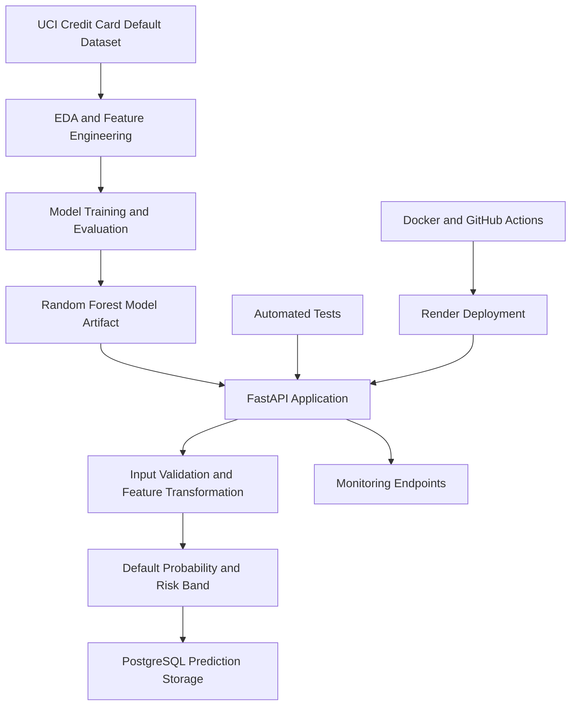

# Credit Risk ML Platform

An end-to-end machine learning platform for credit default prediction, risk classification, explainability, and API-based inference.

**Live API:** [credit-risk-ml-platform.onrender.com](https://credit-risk-ml-platform.onrender.com)
**Interactive API documentation:** [Swagger UI](https://credit-risk-ml-platform.onrender.com/docs)
**Repository:** [GitHub](https://github.com/Sarwani-Mallavarapu/credit-risk-ml-platform)

## Overview

The Credit Risk ML Platform demonstrates how a trained machine learning model can be developed, evaluated, served through a REST API, integrated with a relational database, and deployed to the cloud.

The system uses historical credit-card repayment data to estimate default probability and assign a configurable risk category. Prediction results are stored in PostgreSQL, while monitoring endpoints provide visibility into prediction activity and model performance.

The project emphasizes practical machine learning engineering, backend development, model evaluation, testing, deployment, and operational monitoring.

## Key Features

- Exploratory data analysis and feature engineering
- Baseline model comparison and Random Forest hyperparameter tuning
- Classification-threshold analysis for an imbalanced dataset
- SHAP-based model explainability
- Single and batch prediction through FastAPI
- Probability-based risk classification
- PostgreSQL persistence of prediction results
- API-key authentication for prediction history and outcome updates
- Prediction, drift, trend, and model-performance monitoring endpoints
- Automated API tests with pytest
- Docker configuration and GitHub Actions
- Cloud deployment using Render

## Architecture



### Prediction workflow

1. An applicant's credit and repayment information is submitted to the API.
2. The API validates the request and applies the project's feature-engineering logic.
3. The trained model calculates a default probability.
4. The configured classification threshold and risk boundaries determine the prediction and risk band.
5. The prediction result and associated metadata are stored in PostgreSQL.
6. Monitoring endpoints expose aggregated prediction and performance information.

## Dataset

The project uses the UCI Credit Card Default dataset, containing 30,000 records.

| Target class | Records |
|---|---:|
| No default | 23,364 |
| Default | 6,636 |

The data includes credit limits, demographic attributes, repayment status, bill amounts, and payment amounts.

Dataset source: [UCI Machine Learning Repository — Default of Credit Card Clients](https://archive.ics.uci.edu/dataset/350/default+of+credit+card+clients)

The target distribution is imbalanced, making accuracy alone insufficient for evaluating model quality. Precision, recall, F1, ROC-AUC, and PR-AUC are also considered.

## Feature Engineering

Feature engineering transforms the original monthly credit and repayment variables into additional indicators of repayment behavior and financial patterns.

Examples include:

- `avg_bill_amount`
- `max_bill_amount`
- `total_bill_amount`
- `bill_amount_std`
- `max_repayment_status`
- `avg_repayment_status`
- `months_serious_delay`
- `months_with_delay`
- `recent_repayment_status`
- `total_payment_amount`
- `avg_payment_amount`
- `payment_to_bill_ratio`
- `age_group`

The transformation logic is implemented in `src/features/engineering.py` so that the API can apply the required transformations during inference.

## Model Development and Evaluation

Multiple baseline classifiers were evaluated before selecting and tuning the Random Forest model.

### Baseline model comparison

| Model | Accuracy | Precision | Recall | F1 | ROC-AUC | PR-AUC |
|---|---:|---:|---:|---:|---:|---:|
| Random Forest | 0.8182 | 0.6630 | 0.3617 | 0.4681 | 0.7791 | 0.5553 |
| Decision Tree | 0.816 | 0.664 | 0.339 | 0.449 | 0.759 | 0.510 |
| Logistic Regression | 0.812 | 0.662 | 0.307 | 0.419 | 0.754 | 0.524 |

### Tuned Random Forest

The selected model was tuned using `RandomizedSearchCV` with five-fold cross-validation and ROC-AUC as the optimization metric.

| Parameter | Value |
|---|---|
| `n_estimators` | 400 |
| `max_depth` | 8 |
| `max_features` | `None` |
| `min_samples_split` | 20 |
| `min_samples_leaf` | 20 |
| `class_weight` | `balanced` |
| Cross-validation ROC-AUC | 0.7857 |

### Test-set results

| Metric | Score |
|---|---:|
| Accuracy | 0.7722 |
| Precision | 0.4878 |
| Recall | 0.6014 |
| F1 score | 0.5386 |
| ROC-AUC | 0.7797 |
| PR-AUC | 0.5527 |

The tuned model improves recall relative to the baseline Random Forest, identifying a larger proportion of actual defaults at the cost of lower precision. This trade-off is important when evaluating an imbalanced classification problem.

These results are offline test-set metrics; they do not establish future production performance.

## Classification Threshold and Risk Bands

The API uses a configurable probability threshold of `0.55` for the binary prediction.

Risk categories are assigned as follows:

| Default probability | Risk band |
|---|---|
| Below 0.30 | LOW |
| 0.30 to below 0.55 | MEDIUM |
| 0.55 or above | HIGH |

These are project-defined boundaries for demonstrating risk classification. They are not universal credit-risk standards or validated lending decision rules.

The model artifact and configuration are maintained separately:

- `models/credit_risk_model.joblib`
- `models/model_config.joblib`

## Model Explainability

SHAP was used during model analysis to understand which features contribute to the model's predictions.

Features identified as important include:

- `max_repayment_status`
- `months_with_delay`
- `credit_limit`
- `months_serious_delay`
- `repay_sep`
- `recent_repayment_status`

SHAP values describe feature contributions to model output. They do not establish causality and should not be interpreted as a complete explanation of an individual lending decision.

## REST API

The application is built with FastAPI and exposes interactive documentation through Swagger UI.

### Deployment URLs

- Health: https://credit-risk-ml-platform.onrender.com/health
- Readiness: https://credit-risk-ml-platform.onrender.com/ready
- Swagger UI: https://credit-risk-ml-platform.onrender.com/docs

### Endpoint reference

| Method | Endpoint | Purpose |
|---|---|---|
| `GET` | `/health` | Basic service health check |
| `GET` | `/ready` | Application readiness check |
| `GET` | `/model/info` | Model and configuration information |
| `POST` | `/predict` | Predict for one applicant |
| `POST` | `/predict/batch` | Predict for multiple applicants |
| `GET` | `/predictions/{applicant_id}` | Retrieve stored prediction history |
| `PATCH` | `/predictions/{applicant_id}/outcome` | Record an actual outcome |
| `GET` | `/monitoring/summary` | Prediction summary |
| `GET` | `/monitoring/summary/period?days=7` | Summary for a time period |
| `GET` | `/monitoring/trend?days=7` | Prediction trend information |
| `GET` | `/monitoring/drift?days=7` | Drift-monitoring results |
| `GET` | `/monitoring/performance` | Model performance monitoring |

The history and outcome-update endpoints require the `X-API-Key` header. The remaining endpoint access rules are defined by the application.

### Example prediction request

```json
{
  "applicant_id": "DEMO-001",
  "credit_limit": 50000,
  "gender": 2,
  "education": 2,
  "marital_status": 1,
  "age": 30,
  "repay_sep": 0,
  "repay_aug": 0,
  "repay_jul": 0,
  "repay_jun": 0,
  "repay_may": 0,
  "repay_apr": 0,
  "bill_sep": 20000,
  "bill_aug": 18000,
  "bill_jul": 15000,
  "bill_jun": 12000,
  "bill_may": 10000,
  "bill_apr": 8000,
  "payment_sep": 5000,
  "payment_aug": 5000,
  "payment_jul": 4000,
  "payment_jun": 4000,
  "payment_may": 3000,
  "payment_apr": 3000
}
```

### Example response

```json
{
  "applicant_id": "DEMO-001",
  "default_probability": 0.42,
  "predicted_default": false,
  "risk_band": "MEDIUM",
  "model_version": "v1.0"
}
```

The probability in this example is illustrative; actual output is generated by the deployed model.

## PostgreSQL Persistence

Prediction records are stored in PostgreSQL.

- Database: `credit_risk`
- Table: `predictions`

Stored information includes applicant identifier, default probability, predicted class, risk band, model version, and prediction timestamp.

The application obtains database credentials through environment variables rather than hard-coded secrets.

## Monitoring

The monitoring endpoints provide visibility into prediction activity, trends, drift, and model performance.

Performance evaluation depends on actual outcomes being recorded and enough labeled observations being available. When the configured minimum number of labeled observations has not been reached, the performance monitor may return `INSUFFICIENT_DATA`.

Monitoring outputs should be interpreted as operational indicators, not proof that the model is continuously accurate or free from drift.

## Technology Stack

| Area | Technologies |
|---|---|
| Language | Python |
| Data processing | Pandas, NumPy, SciPy |
| Machine learning | Scikit-learn, Random Forest |
| Explainability | SHAP |
| API | FastAPI, Pydantic, Uvicorn |
| Database | PostgreSQL, psycopg2 |
| Serialization | Joblib |
| Testing | pytest, FastAPI TestClient |
| Containerization | Docker, Docker Compose |
| CI | GitHub Actions |
| Deployment | Render |

## Repository Structure

```text
credit-risk-ml-platform/
├── .github/
│   └── workflows/
├── dashboard/
├── data/
├── database/
│   └── init.sql
├── models/
│   ├── credit_risk_model.joblib
│   └── model_config.joblib
├── notebooks/
│   └── 01_eda.ipynb
├── src/
│   ├── api/
│   │   └── main.py
│   ├── database/
│   │   └── connection.py
│   ├── features/
│   │   └── engineering.py
│   └── config.py
├── tests/
│   └── test_api.py
├── .dockerignore
├── .gitignore
├── Dockerfile
├── docker-compose.yml
├── pytest.ini
├── requirements.txt
└── readme.md
```

## Run Locally

### Prerequisites

- Python 3.10
- PostgreSQL
- Git

### 1. Clone the repository

```powershell
git clone https://github.com/Sarwani-Mallavarapu/credit-risk-ml-platform.git
cd credit-risk-ml-platform
```

### 2. Create a virtual environment

```powershell
python -m venv .venv
.venv\Scripts\Activate.ps1
```

If PowerShell blocks activation, use the Python executable inside `.venv` directly or adjust your local execution policy as appropriate.

### 3. Install dependencies

```powershell
python -m pip install -r requirements.txt
```

### 4. Configure PostgreSQL

Create a database named `credit_risk`. Initialize the schema using the project's `database/init.sql` script or the documented schema setup for your environment.

### 5. Configure environment variables

Create a local `.env` file in the repository root:

```dotenv
DB_HOST=localhost
DB_PORT=5432
DB_NAME=credit_risk
DB_USER=postgres
DB_PASSWORD=replace_with_your_local_password
API_KEY=replace_with_a_long_random_secret
```

Use your own local values. Never commit `.env` or share API keys and passwords publicly.

### 6. Start the API

From the repository root:

```powershell
python -m uvicorn src.api.main:app --reload
```

Open the interactive documentation at:

http://127.0.0.1:8000/docs

The API requires the configured environment variables and the project's model artifacts to be available.

## Testing

Run the automated tests from the repository root:

```powershell
pytest -v
```

The test suite covers API behavior, request validation, prediction flows, error handling, monitoring behavior, and authentication for protected endpoints.

The latest local verification recorded during project development was **25 passed, 0 failed**. Rerun the tests after any subsequent changes to confirm the current result.

## Deployment

The API is deployed on Render and can be accessed at:

https://credit-risk-ml-platform.onrender.com

The Dockerfile and Docker Compose configuration are included for containerized deployment and local infrastructure setup. Validate the current Compose configuration and environment-variable propagation before relying on it as a reproducible deployment path.

For the hosted service, configure database credentials and `API_KEY` through Render's environment settings. Do not put secrets in source code or documentation.

## Security Considerations

- API keys and database passwords are supplied through environment variables.
- Prediction history and outcome updates require an API key.
- The application uses request validation and automated tests to check expected behavior.
- The hosted demo is not intended to process real applicant information.

Before using a system like this with real lending data, additional controls would be required, including broader endpoint authentication, authorization, rate limiting, secure database networking, secret rotation, audit controls, privacy safeguards, fairness evaluation, and formal model validation.

## Limitations

- The model was evaluated on a historical dataset; its performance may change on new populations.
- The selected probability threshold and risk boundaries are demonstration settings.
- SHAP feature contributions do not establish causation.
- Production performance monitoring depends on sufficient actual outcome labels.
- Drift indicators do not by themselves prove model degradation.
- The project has not been validated for real lending decisions or regulatory compliance.

## Future Scope

Potential future extensions include a richer monitoring dashboard, expanded security controls, automated monitoring alerts, and more comprehensive model governance. These are possible extensions rather than claims about the current implementation.

## Author

**Sarwani Mallavarapu**

Software Development Engineer | Python, Data Engineering, Machine Learning and Backend Development

- [GitHub](https://github.com/Sarwani-Mallavarapu)
- [LinkedIn](https://www.linkedin.com/in/sarwani-m/)

## Disclaimer

This project is for educational and portfolio demonstration purposes only. It must not be used as the sole basis for lending, credit approval, or other consequential financial decisions.
